# Week 07 — Sequence Modeling and Transformers

[← Generative Models](week-06-generative-models.md) · **Week 7 of 11** · [Next: World Models →](week-08-world-models.md)

**Know these first:** reactive policies, RNNs, MDP, POMDP
**Topics:** RNNs, transformers, ViTs, LLMs, VLMs, VLAs (basic)
**Before the session:** *Attention Is All You Need*; ACT paper (Zhao et al.); FAST paper (Pertsch et al.); pen and paper for the attention example.

## Core notes

### 0. Glossary

| Term | Meaning |
|---|---|
| Token | One unit the model reads: a subword, an image patch, or an action value |
| Embedding | Vector of numbers representing a token |
| Autoregressive | Generates one token at a time, each conditioned on all earlier ones |
| Policy | Maps what the robot sees to what it does |
| Trajectory | One full run: observation, action, observation, action, ... |
| Hidden state | Fixed-size summary of the past that an RNN carries forward |
| KV cache | Stored keys and values of past tokens, so they are not recomputed each step |
| Prefill / decode | Reading the prompt all at once / generating tokens one by one |

### 1. Why one frame is not enough

Reactive policies map the current observation $o_t$ to an action $a_t$. Two problems:

- **Memory.** One image cannot show speed, or that the road was icy earlier. Real robots are in a POMDP: the frame is a partial view of the state.
- **Jerky motion.** Independent per-step actions oscillate.

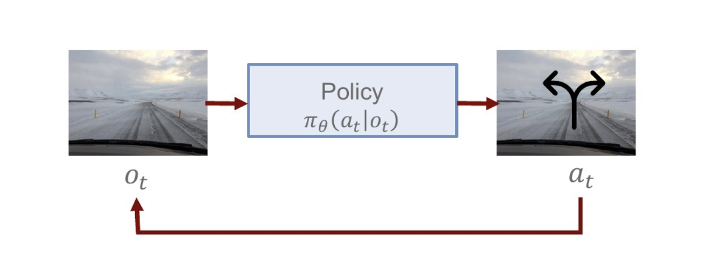

Fix: model the whole **sequence** of observations and actions.

### 2. The trajectory equation

$$
p_\pi(\tau) = \rho(s_0) \prod_{t=0}^{T-1} \pi(a_t \mid o_t)\, P(o_{t+1} \mid o_t, a_t)
$$

| Piece | Meaning |
|---|---|
| $\rho(s_0)$ | How the world starts (e.g. random object positions) |
| $\pi(a_t \mid o_t)$ | Policy: how likely is this action given what the robot sees |
| $P(o_{t+1} \mid o_t, a_t)$ | The world's reply to the action |

Only $\pi$ depends on the policy parameters, so when you differentiate $\log p_\pi(\tau)$ the $\rho$ and $P$ terms drop out. You can train a policy without knowing the physics.

**Where it breaks.** The simple form is exact only if $o_t$ is a **sufficient statistic** of the hidden state (truly, physics moves a hidden state and a sensor reads it out). Example: a gripper closes on a cube, with identical images and commands, but the cube is heavy in one run and light in the other. The camera cannot see mass, so no single $P(o_{t+1} \mid o_t, a_t)$ fits both. The fix is to condition on the full history: $\pi(a_t \mid h_t)$. Papers still use the simple form as shorthand, usually with frame stacking or a wrist camera.

### 3. Chain rule and RNNs

Any sequence splits into conditionals (this is autoregressive modeling):

$$
p(x_1, \dots, x_T) = \prod_{t=1}^{T} p(x_t \mid x_1, \dots, x_{t-1})
$$

An **RNN** models each conditional with a hidden state updated each step, $h_t = f(h_{t-1}, x_t)$. Problems:

1. **Long-range memory:** gradients pass back through every step and vanish or explode (LSTMs only slow this).
2. **Slow training:** step $t$ needs step $t-1$, so no parallelism.
3. **Bottleneck:** all history squeezed into one fixed-size vector.

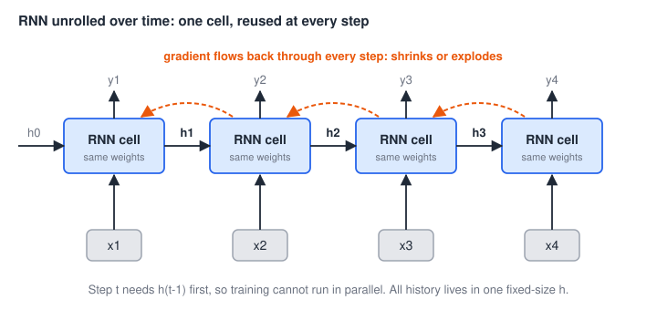

### 4. Attention

Every token looks at every other token in one hop and decides which matter. This fixes all three RNN problems: direct long-range links, parallel training, no single bottleneck vector.

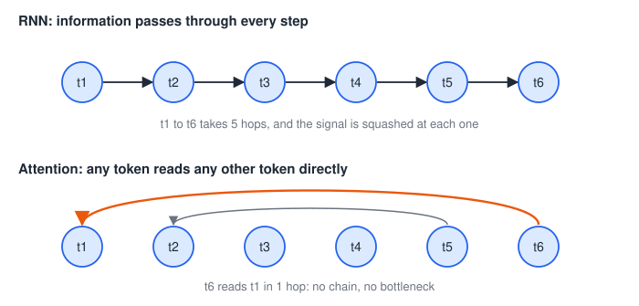

Each token makes three vectors: a **query** $q$ (what I am looking for), a **key** $k$ (what I advertise), a **value** $v$ (what I hand over if chosen). Stack the $n$ token embeddings into $X \in \mathbb{R}^{n \times d_{\text{model}}}$ and project:

$$
Q = XW_Q,\qquad K = XW_K,\qquad V = XW_V
$$

$$
\boxed{\text{Attention}(Q,K,V) = \text{softmax}\!\left(\frac{QK^\top}{\sqrt{d_k}} + M\right)V}
$$

| Piece | Shape | What it does |
|---|---|---|
| $W_Q, W_K, W_V$ | $d_{\text{model}} \times d_k$ | Learned projections that create $q$, $k$, $v$ |
| $QK^\top$ | $n \times n$ | Entry $(i,j)$ = dot product of query $i$ with key $j$: how relevant token $j$ is to token $i$ |
| $\sqrt{d_k}$ | scalar | Dot products of $d_k$-dim vectors have variance $\propto d_k$. Without scaling, large scores saturate softmax and gradients vanish |
| $M$ | $n \times n$ | Mask: $0$ where allowed, $-\infty$ for future tokens in causal attention, so their weight becomes 0 |
| softmax | row-wise | Turns each row into positive weights summing to 1 |
| $\cdot V$ | $n \times d_v$ | Each output is the weighted average of all value vectors |

It is a **soft dictionary**: a normal dictionary returns one entry, attention returns a blend of all entries weighted by key-query match. Everything is differentiable, so the model learns both what to store in $q, k, v$ and where to look. **Multi-head:** run $h$ attentions in parallel with their own $W_Q, W_K, W_V$ (and $d_k = d_{\text{model}}/h$), concatenate, apply $W_O$.

**Worked example** (scores already scaled). Token "it" scores $[2, 1, 0]$ against ["robot", "picked", "spoon"]: $e^2, e^1, e^0 = 7.39, 2.72, 1$ (total $11.11$) gives weights $[0.67, 0.24, 0.09]$. Output $= 0.67\,v_{\text{robot}} + 0.24\,v_{\text{picked}} + 0.09\,v_{\text{spoon}}$.

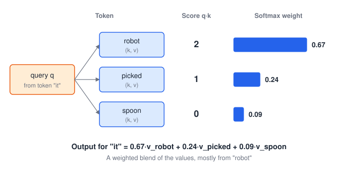

**Positional encodings.** The dot product ignores order, so position must be injected.

| Type | Idea | Note |
|---|---|---|
| Absolute | Add a fixed vector per position | Fails beyond training length |
| Relative | Bias scores by token distance | Generalizes to longer sequences |
| RoPE | Rotate $q, k$ by a position-proportional angle, so the dot product depends only on distance | Used in most modern LLMs |

### 5. The original transformer

- **Encoder:** *bidirectional* self-attention (full input is available).
- **Decoder:** *causal* self-attention (the mask $M$ above), so each token sees only itself and earlier tokens.
- **Cross-attention:** queries from the decoder, keys and values from the encoder.

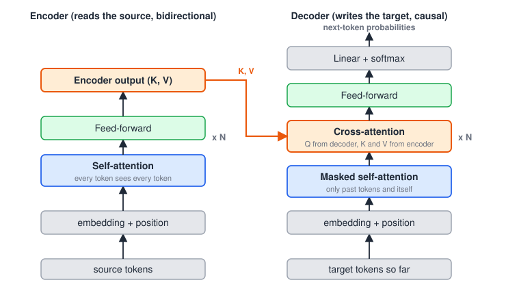

**Teacher forcing.** In training, feed the true previous tokens and predict the next true token (cross-entropy). With the causal mask, one forward pass gives the loss at every position at once. An RNN needs one step per token.

### 6. The KV cache

During generation each new token attends to all earlier ones. Earlier keys and values never change, so compute them once and store them. Queries are used only at their own step, so they are not cached.

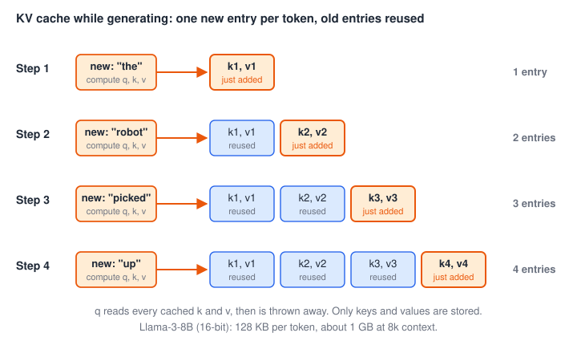

$$
\text{cache size} = 2 \times n_{\text{layers}} \times n_{\text{kv heads}} \times d_{\text{head}} \times L \times B \times \text{bytes}
$$

($L$ = sequence length, $B$ = batch size, 2 = key + value.) Llama-3-8B, 16-bit (32 layers, 8 KV heads, $d_{\text{head}}=128$): **128 KB per token**, about 1 GB at 8k context, about 16 GB at 128k.

Two different memory problems:

| | Attention matrix | KV cache |
|---|---|---|
| Hurts during | Training, prefill | Decode |
| Grows as | $L^2$ | $L$ |
| At $L$ = 8k | ~4 GB per layer per sequence | ~1 GB whole model |
| Needed later? | No, temporary by-product | Yes |

**FlashAttention** computes attention in small tiles in fast on-chip memory and never stores the full $n \times n$ matrix (memory $O(n)$, same answer). It fixes the matrix, not the cache, because the cache holds information later tokens need.

### 7. KV cache vs RNN hidden state

The real difference is **when the model decides what to keep**.

| | RNN hidden state | KV cache |
|---|---|---|
| Size | Fixed, $O(d)$ | Grows, $O(L \cdot d)$ |
| Past tokens | Blended into one summary | Stored separately, never overwritten |
| What to keep is decided | At write time, blind to future questions | At read time, by the current query |
| Access to old tokens | Through the bottleneck | Direct, one hop |
| Training | Sequential in $L$ | Parallel over $L$ |
| Cost per generated token | $O(d^2)$, constant | $O(L \cdot d)$, grows |

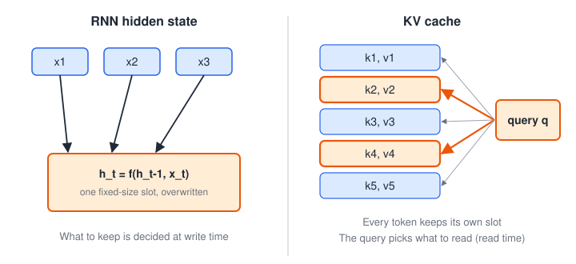

### 8. Tokens and LLMs

Subword tokens balance vocabulary size against sequence length: characters give very long sequences, whole words cannot represent unseen words, and attention cost is quadratic in length.

**Byte Pair Encoding (BPE)** builds the vocabulary from data:

1. Start with single characters (or raw bytes) as the vocabulary.
2. Count adjacent pairs and merge the most frequent pair into a new token.
3. Repeat until the vocabulary reaches the target size (e.g. ~100k).

Common pieces merge early (t + h → th, th + e → the); a rare or brand-new word still splits into known smaller pieces. **Byte-level BPE** starts from raw bytes, so any input (emojis included) can be encoded. At internet scale it gives about 3-4x compression over characters. BPE only works on discrete symbols, which is why continuous actions must be made discrete before it can be used (section 11).

**LLMs** are decoder-only transformers trained on plain next-token prediction. Scale brought new abilities: zero-shot behavior (GPT-2) and in-context learning (GPT-3, 175B parameters: show a few examples in the prompt and it picks up the pattern with no weight updates).

### 9. Vision transformers (ViT)

To feed images to a transformer, change only the tokenizer: cut the image into patches and treat each patch as a token.

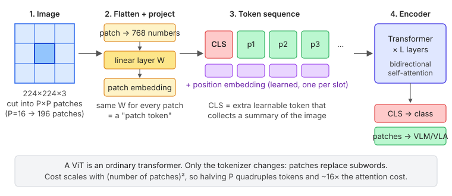

1. **Patchify.** Split the image into $P \times P$ patches (224×224 with $P=16$ gives 14×14 = 196 patches).
2. **Embed.** Flatten each patch ($16 \cdot 16 \cdot 3 = 768$ numbers) and apply one shared linear layer (768 → 768).
3. **Add position.** Prepend a learnable **[CLS]** token (196 patches + [CLS] = 197 tokens) and add a learned position embedding to every token.
4. **Encode.** Standard transformer encoder with *bidirectional* attention (no mask).
5. **Use the output.** [CLS] feeds a classifier, or the patch tokens go on as image tokens for a VLM or VLA.

Cost grows with (number of patches)$^2$, so smaller patches mean more tokens and much more attention cost.

### 10. Vision + language (VLMs)

Simply concatenating image and text tokens does not tell the model which words go with which region. Four ways to connect them, from least to most integrated: CLIP (no LLM), early fusion (image tokens enter the LLM input), late fusion (vision enters inside the LLM via cross-attention), native (everything trained together).

#### CLIP: two-tower contrastive alignment (Radford et al., 2021)

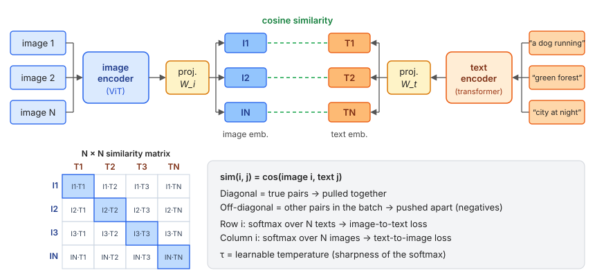

An image encoder (a ViT) and a text encoder (a transformer), each followed by a projection ($W_i$, $W_t$) into one shared space. Train on image-text pairs: a batch of $N$ pairs gives an $N \times N$ matrix of cosine similarities $s_{ij}$, and the diagonal holds the true pairs.

$$
\mathcal{L}_{\text{CLIP}} = -\frac{1}{2N}\sum_{i=1}^{N}\left[\log\frac{e^{s_{ii}/\tau}}{\sum_{j=1}^{N} e^{s_{ij}/\tau}} + \log\frac{e^{s_{ii}/\tau}}{\sum_{j=1}^{N} e^{s_{ji}/\tau}}\right]
$$

- **First term (image-to-text):** softmax over row $i$. Given image $i$, pick its text out of $N$.
- **Second term (text-to-image):** softmax over column $i$. Given text $i$, pick its image out of $N$.
- Each is an $N$-way cross-entropy with the diagonal as the correct class. The other $N-1$ pairs in the batch act as negatives, so bigger batches give a stronger signal.
- $\tau$ is a **learnable temperature**: small $\tau$ gives a sharp (low-entropy) softmax, large $\tau$ a flat one.
- Result: matching images and text land close together, but there is no language model to generate or reason. Its ViT is reused by LLaVA.

#### Early fusion: LLaVA (Liu et al., 2023)

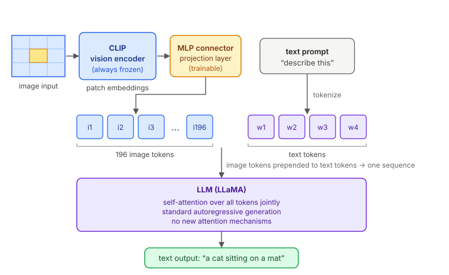

- Frozen CLIP vision encoder → trainable **MLP connector** → 196 image tokens, **prepended** to the text tokens.
- The LLM (LLaMA) runs ordinary self-attention over all tokens jointly and generates autoregressively. No new attention mechanisms.
- Richest image-text interaction, but finetuning risks hurting the LLM. Most common in open source (LLaVA, PaliGemma, Gemma 3).

#### Late fusion: Flamingo (Alayrac et al., 2022)

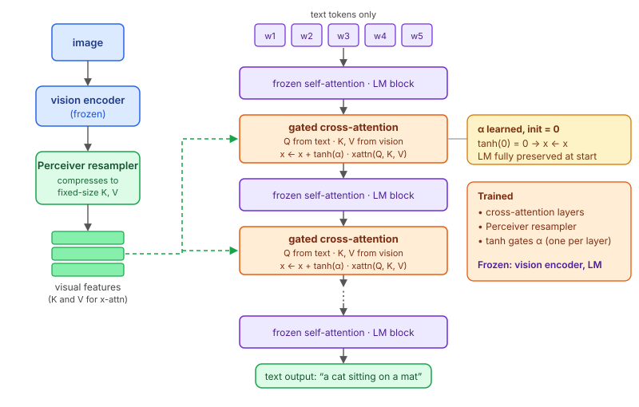

- Frozen vision encoder → **Perceiver resampler** (compresses to fixed-size keys and values) → **gated cross-attention** layers inserted between frozen LM layers. The LM never sees image tokens directly; text queries look at the visual K, V.

$$
x \leftarrow x + \tanh(\alpha)\cdot \text{XAttn}(Q_{\text{text}}, K_{\text{vision}}, V_{\text{vision}})
$$

- $\alpha$ is learned per layer and **starts at 0**, so $\tanh(0)=0$ and the model begins as exactly the original LM; vision is let in gradually.
- Trained: cross-attention layers, resampler, gates. Frozen: vision encoder, LM. Keeps the LM intact, but gives vision and text fewer ways to interact.

#### Native multimodal

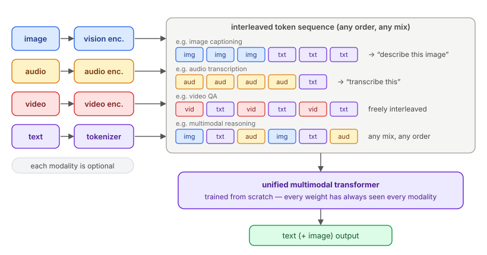

- Instead of adding vision to an existing LLM, train one transformer **from scratch** on an interleaved stream of text, image, audio and video tokens (each modality has its own encoder or tokenizer; any mix, any order; each is optional).
- Every weight has always seen every modality, so there is no modality bias. Most expensive, and where big proprietary models are heading.

### 11. Robot actions as tokens (VLAs)

Same recipe: tokenize the new modality, feed one transformer, scale. Inputs are language and image tokens; outputs are **action tokens**. Attention over history also helps the memory problem. The open question is how to tokenize continuous actions.

#### Naive tokenization: binning (RT-2, OpenVLA)

1. Per action dimension, clip to the 1st-99th percentile and map to $[-1, 1]$ (min-max would let one outlier squash everything else).
2. Split into 256 bins; each bin is a token.
3. Reuse the 256 least-used LLM vocabulary tokens as the action tokens.
4. Train with the usual next-token cross-entropy.

**It breaks at high control frequency.** As frequency increases, information per token decreases (neighboring actions barely differ) and correlation between consecutive tokens increases. The model can score well by copying the previous token without learning the skill. In the lecture's results, task success peaks around 5 Hz and is near zero by 20 Hz. The fix is **compression**.

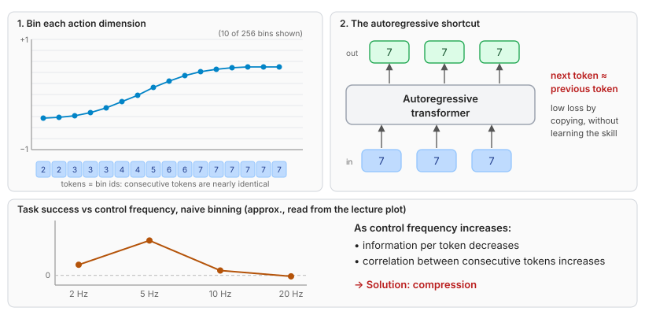

#### Effective tokenization: DCT + BPE

How do you compress continuous robot data? BPE alone is not suited to continuous values, and learned compression (VQ) is complex to train. Key idea: the **Discrete Cosine Transform (DCT)**, the same idea behind JPEG. A smooth action chunk is a sum of cosines of increasing frequency, and most of the information sits in a few low-frequency coefficients:

$$
c_k = \sum_{t=0}^{T-1} a_t \cos\!\left(\frac{\pi}{T}\left(t+\tfrac12\right)k\right),\qquad k = 0,\dots,T-1
$$

Quantizing the coefficients to integers zeroes out most high-frequency terms. The result is a sparse integer matrix that BPE can then compress.

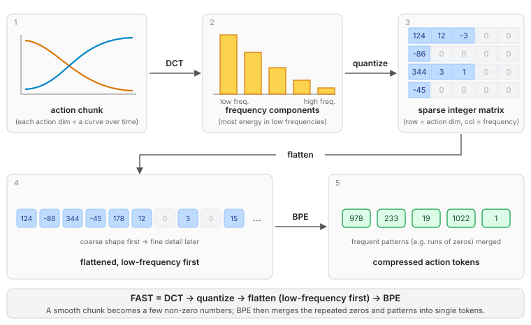

#### FAST (Pertsch et al., RSS 2025)

**F**requency-space **A**ction **S**equence **T**okenization applies the pipeline above to each action chunk (section 12): DCT per action dimension, quantize, flatten with **low-frequency components first** (the model predicts coarse shape before fine detail), then BPE. This gives far fewer, more informative tokens per chunk. It scales to high control frequencies where binning collapses, and trains about 5x faster than the π0 baseline.

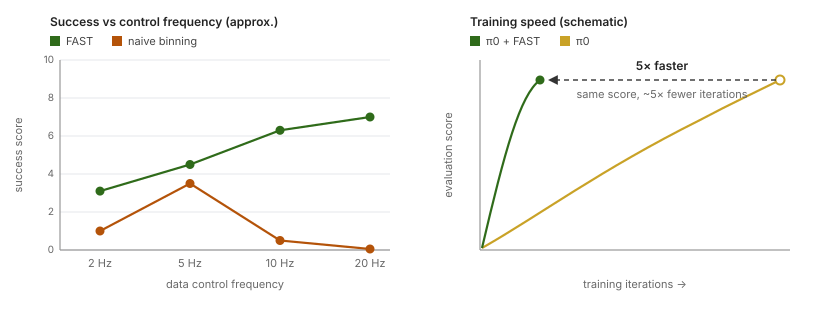

### 12. Action chunking

Predict the next $k$ actions as a chunk, run them, then query again. Actions are planned together, so motion is smoother.

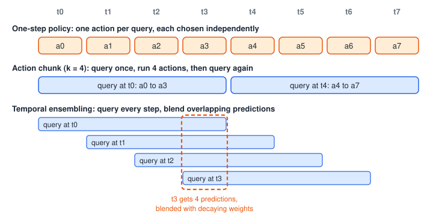

- Long chunks (e.g. 100) leave the robot blind while the chunk runs.
- **Temporal ensembling:** query every step, so each timestep gets several overlapping predictions, blended with exponentially decaying weights. Keeps smoothness and stays responsive.

#### ACT: Action Chunking with Transformers (Zhao et al., 2023)

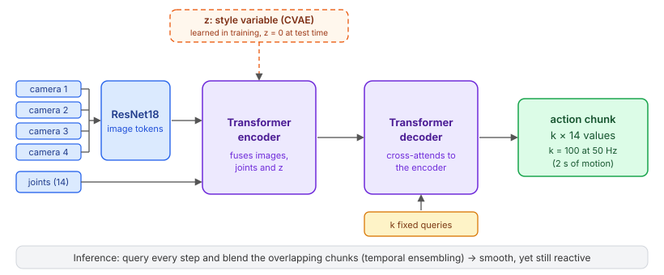

The policy that made chunking work, built for the low-cost bimanual **ALOHA** robot (14 joints, 50 Hz) and trained by imitation on human teleoperation demos. It is a specialist policy with no LLM, and it handles precise two-arm tasks like battery insertion, where a one-step reactive policy at 50 Hz would struggle.

- **Input:** 4 camera images (each goes through a ResNet18 into feature tokens) plus the 14 joint positions.
- **Model:** a transformer **encoder** fuses all the tokens. A transformer **decoder** with $k$ fixed position queries cross-attends to it and outputs the whole chunk in one forward pass: $k = 100$ actions × 14 joints = 1,400 values, about 2 seconds of motion.
- **Why chunk:** the effective horizon shrinks $k$-fold, so errors compound less, and the motion comes out smooth.
- **Training:** a CVAE. A latent $z$ absorbs the variation between human demos (different paths, pauses), so the policy does not average them into a bad action. $z = 0$ at test time.
- **Inference:** query at every step and blend the overlapping chunks with temporal ensembling, weights $w_i = e^{-m i}$ ($i = 0$ is the oldest prediction; a smaller $m$ lets new observations in faster).

---

[← Generative Models](week-06-generative-models.md) · [Next: World Models →](week-08-world-models.md)