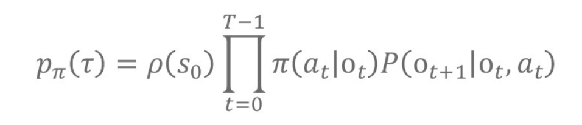

# Week 07 — Sequence Modeling and Transformers

[← Generative Models](week-06-generative-models.md) · **Week 7 of 11** · [Next: World Models →](week-08-world-models.md)

# Week 07: Sequence Modeling and Transformers

## Do you know these?

- Reactive Policies
- RNNs
- MDP
- POMDP

## Topics we will see

- RNNs
- Transformers
- LLMs
- VLMs
- VLAs (basic)

## Outcomes

By the end of the session, members should be able to:

- explain why a policy that sees one frame at a time struggles, and what "sequence modeling" changes;
- explain in plain words what attention computes (query, key, value) and why transformers replaced RNNs;
- describe tokens, positional encodings, causal masking and teacher forcing;
- read the trajectory probability equation and say where it breaks for real robots;
- explain what the KV cache stores, how big it gets, and how it differs from an RNN hidden state;
- explain how language, images and robot actions can all be fed to one transformer, and why action chunking makes motion smoother.

## Before the session

- Attention is all you need
- ACT paper (Zhao et al.)
- Bring: pen and paper for the attention example below.

## Core notes

### 0. Quick glossary

| Term | Meaning |
|---|---|
| Token | One unit the model reads: a subword, an image piece, or an action value |
| Embedding | A vector of numbers that represents a token |
| Sequence model | A model that reads an ordered list of tokens and predicts what comes next |
| Autoregressive | Generates one token at a time, each conditioned on all earlier ones |
| POMDP | A decision problem where the agent sees only part of the true state |
| Policy | The function that maps what the robot sees to what it does |
| Trajectory | One full run of the robot: observation, action, observation, action, ... |
| KV cache | Stored keys and values of past tokens so they are not recomputed at every generation step |
| Hidden state | The fixed-size summary of the past that an RNN carries forward |
| Residual stream | The running vector for each token that every transformer layer reads from and adds to |
| Prefill / decode | Reading the prompt all at once / generating new tokens one by one |

### 1. Why one frame is not enough

So far our policies were **reactive**: take the current observation o_t, output an action a_t. Two problems show up on real robots.

- **Memory.** One image cannot tell you how fast a pedestrian is moving, or that the road was icy a few seconds ago. Real robots live in a POMDP: the current frame is only a partial view of the state.
- **Jerky motion.** If the model picks one action per step independently, small changes between steps add up to oscillating, non-smooth trajectories.


Idea for today: stop modeling just the next action and model the whole **sequence** of observations and actions. The world is sequential, so the model should be too.

### 2. The trajectory equation (what we are really modeling)

A **trajectory** τ is one complete run of the robot: a starting state, then observation, action, observation, action, and so on until the end. The probability that a policy π produces one particular run is:



| Piece | Plain meaning |
|---|---|
| ρ(s₀) | How the world starts. E.g. the random positions of objects on the table |
| π(a_t \| o_t) | The policy: given what the robot sees, how likely is it to pick this action? It depends on the observation, not the true hidden state, which is the "partially observable" part |
| P(o_{t+1} \| o_t, a_t) | The world's reply: given what I saw and what I did, how likely is this next observation? |
| ∏ (product) | Multiply the step-by-step probabilities together (the chain rule from the next section) |

**Read it as a recipe for generating one run:**

1. Draw a starting state s₀ and get the first observation o₀.
2. The policy samples an action a₀.
3. The world responds with o₁.
4. Repeat until the end.

Multiplying the probability of each of those choices gives the probability of that exact run. It splits into a simple product because each factor only looks at the previous step.

**Why does the product stop at T-1?** There are T transitions but T+1 observations, because the last action produces the final observation o_T.

#### What is the P term, and where does it go wrong?

P is the world's half of the loop. You send an action (say a joint velocity), the world sends back the next observation (say a camera image). It is a probability distribution, not a single answer, because of motor slip, contact, sensor noise and things the robot cannot see.

In reality there is a hidden state in the middle, and two steps happen:

1. Physics moves the hidden state: `P(s_{t+1} | s_t, a_t)`.
2. The sensor turns that state into what the robot sees: `O(o_{t+1} | s_{t+1})`.

The more honest version of the equation, with h_t as the **full history** of observations and actions, is:

```
p(τ) = ρ(s₀) ∏ π(a_t | h_t) · P(s_{t+1} | s_t, a_t) · O(o_{t+1} | s_{t+1})
```

The simple equation squashes both steps into one term. That is only exact if the current observation contains everything the robot needs to know (formally, a **sufficient statistic** of its belief about the state).

**Example where it fails:** a gripper closes on a cube. Two rollouts have identical camera images and identical commands, but the cube is heavy in one and light in the other. The next frames differ, and the camera cannot see mass. No single `P(o_{t+1} | o_t, a_t)` can describe both cases. The correct thing to condition on is the whole history.

**Why people use the simple form anyway:** you can make the observation nearly sufficient with tricks (stacking a few frames, adding a wrist camera, using a recurrent or transformer policy over history). Most imitation learning and VLA papers use the simple notation as shorthand for "we treat the observation as the state, and it works well enough." This lecture is about the proper fix: condition on history.

### 3. The chain rule: how to model any sequence

Any joint probability can be split into a product of conditionals:

```
p(x_1, x_2, ..., x_T) = p(x_1) · p(x_2 | x_1) · p(x_3 | x_1, x_2) · ...
```

In words: predict the first item, then the second given the first, then the third given the first two, and so on. This is **autoregressive** modeling. The open question is how to build a model for each conditional, because a lookup table is impossible for long, high-dimensional sequences (video, robot trajectories).

### 4. RNNs: the first answer, and why it struggles

An RNN keeps a **hidden state**: a running summary of everything seen so far. At each step it reads the new input and updates the summary. It handles any sequence length, but has three problems:

1. **Long-range memory is hard.** To use information from step 1 at step 100, gradients must pass back through 99 steps and tend to vanish or explode. LSTMs help but do not fully fix it.
2. **Slow to train.** Step t needs step t-1 first, so you cannot process steps in parallel.
3. **Bottleneck.** The whole history is squeezed into one fixed-size vector, however long the sequence is.

### 5. Attention, from the ground up

**Intuition.** Reading a sentence, each word should be able to look back at the other words and decide which ones matter for its meaning. Attention does exactly that, with no step-by-step chain. Any token can look at any other token in one hop (path length O(1)). That removes all three RNN problems: long-range links are direct, training is parallel, and there is no single bottleneck vector.

**The library analogy.** For each token, the model builds three vectors:

- **Query (q):** what this token is looking for.
- **Key (k):** what each token advertises about itself.
- **Value (v):** the information each token will hand over if chosen.

**Three steps:**

1. **Score.** Dot product of the query with every key. Bigger means more relevant.
2. **Normalize.** Softmax turns scores into weights that are positive and sum to 1.
3. **Mix.** Output is the weighted average of the value vectors.

**Tiny worked example.** Token "it" has scores against three tokens ["robot", "picked", "spoon"] of [2, 1, 0].

- Softmax: e² = 7.39, e¹ = 2.72, e⁰ = 1, total 11.11.
- Weights: [0.67, 0.24, 0.09].
- Output for "it" = 0.67·v_robot + 0.24·v_picked + 0.09·v_spoon. It mostly pulls in information from "robot".

**Why this is called a soft dictionary.** A normal dictionary returns exactly one entry for a key. Attention returns a blend of all entries, weighted by how well each key matched the query. Because every step is differentiable, the model learns both what to store in q, k, v and where to look.

**Positional encodings (order matters).** The dot product ignores order, so "the robot picked up the spoon" and "the spoon picked up the robot" look identical. We must inject position.

| Type | Idea | Catch or benefit |
|---|---|---|
| Absolute | Add a fixed position vector to each token embedding | Breaks on sequences longer than anything seen in training |
| Relative | Encode the distance between tokens, e.g. as a bias on the attention score | Works on unseen lengths; "spoon" knows "robot" is 4 steps away wherever they sit |
| RoPE | Rotate q and k by an angle proportional to position, so the dot product depends only on distance | Used in most modern LLMs |

### 6. The original transformer

Built for translation, so it has two halves:

- **Encoder:** reads the source sentence with **bidirectional** self-attention (every token sees every other, past and future). The full input is available, so we want the richest representation.
- **Decoder:** writes the target sentence with **causal** self-attention. A triangular **mask** sets scores for future tokens to minus infinity before softmax, so they get weight 0. Each token only sees itself and earlier tokens, which is what makes generating one token at a time possible.
- **Cross-attention:** the bridge between the two. Queries come from the decoder, keys and values from the encoder: "given what I have written so far, which part of the source matters now?"

**Training with teacher forcing.** During training we always feed the true previous tokens, not the model's own guesses, and ask it to predict the next true token (cross-entropy loss). Because of the causal mask, one forward pass gives the loss at every position at once. An RNN would need a separate step per token.

### 7. The KV cache: where the memory goes

**The idea.** When a decoder generates text one token at a time, each new token has to attend to every earlier token. The key and value of an earlier token never change once it exists, so recomputing them every step would be wasteful. We compute them once and store them. This store is the **KV cache**. Queries are different: a token's query is only used at its own step, so queries are not cached.

Per token, per layer and per attention head, the cache holds one key (used to find the token) and one value (the information it carries).

**How big is it?**

```
cache size = 2 × n_layers × n_kv_heads × head_dim × seq_len × batch × bytes_per_number
```

(The 2 is for key plus value.) Example, Llama-3-8B in 16-bit numbers (32 layers, 8 KV heads, head dimension 128):

- 2 × 32 × 8 × 128 × 2 bytes = **128 KB per token**.
- About 1 GB at 8k tokens of context, about 16 GB at 128k tokens.
- The model weights alone are about 16 GB, so batch 8 at 128k context will not fit on an H100 from the cache alone.

**Two different memory problems get mixed up.** They have different causes and different fixes:

| | Attention matrix | KV cache |
|---|---|---|
| When it hurts | Training and reading the prompt (prefill) | Generating token by token (decode) |
| Size grows as | L² (L = sequence length) | L |
| At L = 8k | About 4 GB per layer per sequence (32 heads, 16-bit) | About 1 GB for the whole model |
| Is it needed information? | No, it is a temporary by-product | Yes, later tokens need it again |

#### The big L² matrix: just don't build it

Attention normally compares every token with every other token, which makes a giant table of scores. FlashAttention skips building that table. It works through the keys in small chunks, keeps a running total so the softmax still comes out exact, and in the backward pass it recomputes the chunks instead of saving them. Fused linear cross-entropy does the same thing for the huge `[batch × seq, vocab]` logit tensor, working through it in pieces. In both cases the giant table was only a side effect of how we chose to compute, not something we actually need to keep.

#### The KV cache: can't skip it, so shrink it

The KV cache is different. It is the model's stored memory of everything it has already read, and it has to be read again for every new token. You can't recompute your way out of it, so the fixes all try to store less:

- **GQA / MQA:** several query heads share the same key and value heads. Llama-3 uses 8 KV heads for 32 query heads, a 4x cut.
- **MLA (DeepSeek):** store a small compressed (low-rank) version and expand it when needed, roughly 10x smaller.
- **Sliding window:** keep only the last W tokens. Mistral mixes these layers with full-attention layers, so information can still travel further than W through the depth of the network.
- **PagedAttention (vLLM):** same total size, but stored in fixed blocks like virtual memory in an operating system, so you do not reserve the maximum length for every sequence.
- **Cache quantization:** store the numbers in 8-bit or 4-bit, usually with small quality loss.

**One-line summary:** the L² matrix is waste you can avoid computing, while the KV cache is real memory you can only compress, share, or store more cleverly.

### 8. KV cache vs RNN hidden state

Both are "memory of the past". The real difference is **when the model decides what to keep**.

- An **RNN** updates `h_t = f(h_{t-1}, x_t)`. It overwrites a fixed-size summary at every step. Think of one notebook page that you must rewrite after each new fact. You have to decide what to keep without knowing what you will be asked 500 steps from now.
- The **KV cache** never overwrites anything. Each token's key and value are frozen when the token arrives. Think of a filing cabinet that gets one new folder per token. The choice of what matters is made **at read time**: the current query looks through the folders and pulls out the relevant ones.

| | RNN hidden state | KV cache |
|---|---|---|
| Size | Fixed, O(d) | Grows with length, O(L · d) |
| Past tokens | Blended into one summary | Stored separately |
| What to keep is decided | At write time, blind to future questions | At read time, based on the current query |
| Access to old tokens | Only through the bottleneck | Direct, any token |
| Gradient path back to token 1 | Through L multiplications | One hop |
| Training | Sequential in L | Parallel over L |
| Cost per generated token | O(d²), constant | O(L · d), grows with context |

**Why LSTMs existed.** Backpropagating through L steps multiplies L matrices together, so the signal shrinks or blows up. LSTM gates create a path close to "copy unchanged" along the cell state, which slows the decay but does not remove it. Attention makes the path a single hop, so there is nothing to decay.

### 9. What the cache keeps and what it drops

The cache does not store the token itself. It stores two **projections** of the residual stream (the running vector each layer works on): a key for addressing and a value for the payload.

- In Llama-3-8B the residual vector has 4096 numbers per token. Keys plus values total 2048 numbers (8 heads × 128 each, for K and V), so about half is kept.
- What is lost is whatever the key and value projection matrices (`W_K`, `W_V`) throw away. Those matrices are learned during training and then applied identically to every token. So **what to drop is decided at training time, not per piece of content.**

**Where does the compression happen?**

- An RNN compresses **across time** into one slot. Token 1 and token 500 compete for the same space.
- The KV cache compresses **within each token's features** and never makes tokens compete. Every token keeps its own slot.

**A fair question:** a stored value `v_i` is frozen, so does every future query get the same thing from it? Within one head, yes. The richness comes from three places:

1. **Many heads:** each head has its own `W_K, W_V`, so different heads store different projections of the same token.
2. **Many layers:** 32 layers × 8 KV heads gives about 256 different views of each token.
3. **Contextualization:** at layer 0, a token's key depends only on that token's embedding. By layer 20, the residual at that position has absorbed earlier tokens through 20 rounds of attention, so the same word in two different sentences produces different deep-layer entries.

**Compared with an RNN, the cache can do three things the hidden state cannot:**

- keep a separate slot for every timestep;
- hold several views of the same event;
- reach any old token in one hop.

**Why this matters for robots.** Both architectures compress. An RNN learns a lossy summary of the past (a learned "belief state"). A transformer keeps the raw history and re-reads what it needs, paying memory that grows linearly. For short episodes it is mostly a wash, which is why frame stacking works. For long tasks where the robot must remember something from minutes ago, the difference becomes real.

### 10. Tokens: what does the model actually read?

- **Characters:** tiny vocabulary, but sequences become very long.
- **Whole words:** short sequences, but any unseen word cannot be represented.
- **Subwords:** the middle ground. Attention cost grows with the square of sequence length, so short sequences matter.

**Byte Pair Encoding (BPE):** start with single characters, repeatedly merge the most frequent adjacent pair into a new token, stop at the vocabulary size you want. Common pieces merge early; a brand new word still breaks into known pieces.

Lecture example: "the robots melted the robots unbearably cheesy fondue" goes from 54 characters to 34 tokens (about 37% fewer). More training text means more merges and shorter sequences; at internet scale with a ~100k vocabulary, expect about 3 to 4x compression. **Byte-level BPE** starts from raw bytes so literally any input (emojis included) can be encoded.

### 11. From transformer to large language model

- **Decoder-only:** modern LLMs (GPT style) drop the encoder. Training a causal decoder on plain next-token prediction is simpler to scale and works just as well with enough data.
- **FlashAttention (details in section 7):** standard attention builds the full n x n score matrix, which costs memory growing with n². FlashAttention computes it in small tiles in fast on-chip memory and never stores the whole matrix. Same answer, memory down to O(n).
- **Scale brings new abilities:**
  - GPT-1 (2018): pretrain, then finetune per task.
  - GPT-2 (2019): about 10x more parameters and data; **zero-shot** behavior appears.
  - GPT-3 (2020): 175B parameters, 300B tokens; **in-context learning** appears (show a few examples in the prompt, it picks up the pattern with no weight updates). A 1.3B model stays flat as you add examples; the 175B model becomes a few-shot learner.
- **Bitter lesson (Sutton, 2019):** over 70 years of AI, general methods that scale with compute eventually beat clever handcrafted ones (chess, Go, speech). The open question for robotics: what emerges when we scale robot data?

### 12. Adding vision and language together

An LLM only reads text, but a robot must see. The lecture covers how to connect an image encoder to a language model so both live in one token sequence. Problem: if you simply concatenate image and text tokens, the model does not know which words go with which part of the picture. Three families of solutions:

| Approach | How it works | Trade-off |
|---|---|---|
| **CLIP** (two towers) | A vision encoder and a text encoder trained with a contrastive loss on image-text pairs, so a picture of an apple and the word "apple" land close together | Gives a shared embedding space, but no language model to reason with |
| **Early fusion** (LLaVA) | Frozen CLIP vision encoder, a small trainable MLP connector, image tokens prepended to the text tokens, then ordinary self-attention. LLM is finetuned on visual instruction data | Richest image-text interaction; risk of hurting the LLM. Most common in open source (LLaVA, PaliGemma, Gemma 3) |
| **Late fusion** (Flamingo) | Frozen vision encoder; new cross-attention layers inserted in the LLM where text queries look at visual keys and values. A tanh gate starts at 0, so the model initially behaves exactly like the original LLM and vision is let in gradually | Keeps the LLM intact; limited ways for vision and text to interact |
| **Native multimodal** | One transformer trained from scratch on interleaved text, images, audio, video | No modality bias and the bitter lesson in its purest form, but the most expensive. Where big proprietary models are heading |

### 13. Robot actions as tokens (VLAs)

Same recipe again: find a way to tokenize the new modality, feed it to the same transformer, scale. For robots the inputs are language and image tokens and the outputs are **action tokens** that drive the motors. This is a **vision-language-action (VLA)** model. Attention over the whole history also helps with the memory problem from the start of the lecture.

Actions are continuous, so we **discretize** them (RT-2, OpenVLA style):

1. Per action dimension, compute the 1st and 99th percentile over the training data, clip to that range and map to [-1, 1]. (Min-max scaling would let one outlier squash everything else into a few bins.)
2. Split [-1, 1] into 256 bins.
3. Reuse the 256 least-used tokens in the LLM vocabulary as the action tokens.
4. Train with the same next-token cross-entropy as the LLM.

Known limit: at high control frequency, consecutive action tokens look almost identical, so an autoregressive model can score well by copying the previous token and never learn the skill. Better action tokenization is an active research area.

### 14. Action chunking: the fix for jerky motion

Instead of predicting one action, predict the next **k actions** as a chunk, run them, then query again. All actions in a chunk are planned together, so motion is smoother.

- With long chunks (say 100 actions), the robot is blind while the chunk runs.
- **Temporal ensembling:** query the model at every step, so each future timestep gets several overlapping predictions. Blend them with exponentially decaying weights. You keep the smoothness of chunking and stay responsive to new observations.
- **ACT (Zhao et al.):** bimanual ALOHA robot at 50 Hz, chunks of 100 actions, 14 joints, so 1,400 values per forward pass. It handles precise two-arm tasks like battery insertion, where a one-step reactive policy at 50 Hz would struggle. It is a specialist policy and does not use an LLM.

### Takeaway

Find the right representation, use a general scalable architecture, and let data and compute do the work. The same play took us from text to images to audio and now to robot actions.

## Concept checks

1. A robot sees one camera frame. Name two things it cannot know from that frame alone.
2. In the worked example, scores [2, 1, 0] gave weights [0.67, 0.24, 0.09]. What would the weights look like if all three scores were equal?
3. Why does attention need positional information, and why do relative encodings handle longer sequences better than absolute ones?
4. What does the causal mask do, and why can a transformer compute all its losses in one pass under teacher forcing while an RNN cannot?
5. Why is it better to tokenize into subwords than into characters or whole words?
6. Compare early fusion, late fusion and native multimodal training. Why does Flamingo start its gate at zero?
7. Why does predicting a chunk of actions give smoother motion than predicting one action at a time, and what does temporal ensembling add?
8. In the trajectory equation, which terms disappear when you differentiate with respect to the policy parameters, and why does that matter?
9. Give an example where two identical camera images and identical actions lead to different next images. What does this say about conditioning only on o_t?
10. Why is the KV cache needed during generation, and why are queries not cached?
11. Name the two memory problems in attention (matrix vs cache). Which one does FlashAttention fix, and why can the other not be fixed the same way?
12. An RNN and a KV cache both remember the past. When does each decide what to keep?
---

[← Generative Models](week-06-generative-models.md) · [Next: World Models →](week-08-world-models.md)
